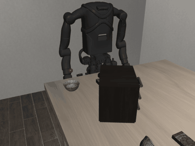

# Kangaroo-RL-Control

Reinforcement learning for the PAL Kangaroo in LIBERO: an object appears on the table and the robot's right
arm (7 joints) reaches for it. The goal is the place where the object appeared, so where the robot is
reaching is always known, and a new object position is just a new goal for the same policy (retargeting).

- **State:** sin/cos positional encoding of the 7 joint angles, plus the goal.
- **Action:** one of 7 velocities per joint.
- **Learning:** goal-conditioned, factored Q-learning with hindsight relabelling, trained on an exact MuJoCo
  model of the arm.
- **Evaluation:** in the Kangaroo_Libero physics simulator.



This page is the run manual: how to set up, test, train, evaluate and redraw everything. The last section
says where everything is.

- The model, the transition rule and the Bellman equation, with derivations: [`TECHNICAL.md`](TECHNICAL.md)
- What came out, and how accuracy changes with training: [`docs/results.md`](docs/results.md)
- How the code is organised: [`docs/architecture.md`](docs/architecture.md)
- The tests and their pass marks: [`docs/tests.md`](docs/tests.md)
- How this repository and Kangaroo_Libero fit together: [`docs/integration.md`](docs/integration.md)

## 1. Setup

You need:
- a Linux amd64 host
- Docker Engine accessible without sudo
- the simulator image `aung9htet/kangaroo-libero:0.1.0-ubuntu-22.04`, pulled (private, ask the owner) or
  built from `sim/Kangaroo_Libero`

An NVIDIA GPU with the Container Toolkit is used for rendering and training when available; everything also
runs on the CPU (`--software`).

```bash
git clone --recursive git@github.com-personal:aung9htet/Kangaroo-RL-Control.git
cd Kangaroo-RL-Control
./run_rl_docker.bash --build --headless -- python -c "import torch, kangaroo_libero; print(torch.__version__)"
```

`--build` makes the image `kangaroo-rl:0.1.0`: the simulator image plus PyTorch 2.5.1 (about 5 GB more). It is
needed once, and again when `docker/` changes. The simulator code that runs is the pinned submodule
`sim/Kangaroo_Libero` (run `git submodule update --init` for a clone made without `--recursive`).

| Launcher option | Effect |
| --- | --- |
| `--headless` | no display; MuJoCo renders offscreen (EGL on NVIDIA, OSMesa otherwise) |
| `--software` | Mesa rendering and CPU compute |
| `--gpu nvidia` | require the GPU |
| `--name NAME` | name the container, for `docker exec -it NAME bash` |
| `-- CMD` | run CMD instead of an interactive shell |

All commands below run inside the container, from the repository root. Prefix them with
`./run_rl_docker.bash --headless --` to run them from the host.

**GPU after suspend.** If `torch.cuda.is_available()` is False after the laptop has slept (`cuInit` error
999 on the host too), reload the NVIDIA unified-memory module once:
`sudo rmmod nvidia_uvm && sudo modprobe nvidia_uvm`. Training falls back to the CPU on its own; the
results in `docs/results.md` were produced on the CPU.

## 2. Test

```bash
python -m pytest -q                 # all tests, about 30 s: encoding, MDP, agent, replay, DP and simulator tests
python -m pytest -q -m "not sim"    # only the fast tests (no LIBERO scene)
```

What each test checks and its pass mark: [`docs/tests.md`](docs/tests.md).

## 3. Measure the robot

```bash
python scripts/probe_model.py
```

This writes `docs/results/probe.json` and two figures:
- `workspace.png`: the reach envelope against the table, for the stock and the chosen robot placement
- `step_response.png`: simulator tracking per joint

It also prints the joint limits, actuator kinds and gains, and the cost of the collision test.

## 4. Train

```bash
python -m kangaroo_rl.train --config configs/reach.yaml --seed 0
```

| Config | What it trains | Steps |
| --- | --- | --- |
| `configs/reach.yaml` | the main experiment: 7 joints, sin/cos encoding, hindsight relabelling | 1 M |
| `configs/reach_raw.yaml` | comparison: raw normalised joint angles instead of sin/cos | 500 k |
| `configs/reach_noher.yaml` | comparison: no hindsight relabelling | 500 k |
| `configs/slice2.yaml` | 2 joints on a lattice, for the exact Bellman check | 300 k |

A run writes `runs/<name>/seed<k>/`:

| File | Contents |
| --- | --- |
| `config.yaml` | the config used |
| `run.json` | the commits of both repositories, the image ID, versions, the simulator settings |
| `metrics.csv` | model evaluation every 25 k steps on 256 held-out goals, from home and chained |
| `train.csv` | loss, mean Q, ε |
| `checkpoints/` | step_00010000.pt … step_01000000.pt and final.pt |

The console prints the chained median error at each evaluation. A 1 M-step run takes about 25 minutes on the
CPU with 6 threads when it runs alone (four in parallel take about 1 h 15 min each).

Values can be overridden without editing a config, e.g. `--set train.steps=200000 agent.hidden=512`.

## 5. Evaluate

```bash
# every checkpoint in the model (256 goals, from home and chained)
python -m kangaroo_rl.evaluate --run runs/reach/seed0 --backend kinematic
# every checkpoint in the simulator: the bowl appears under each of 64 goals; modes A and B
python -m kangaroo_rl.evaluate --run runs/reach/seed0 --backend libero --modes A B --goals 64
# reference controllers (random, Jacobian binned, Jacobian continuous)
python -m kangaroo_rl.evaluate --config configs/reach.yaml --baseline dls --backend kinematic
# the learned 2-joint Q against the exact value-iteration solution
python -m kangaroo_rl.dp_check --run runs/slice2/seed0
# sequential retargeting in the simulator: the bowl reappears every 3 s, no reset
python -m kangaroo_rl.retarget_demo --run runs/reach/seed0
```

Results go to `<run>/eval/` (`*.json` summaries, `*.npz` errors after every step). Simulator modes:
- **A:** the policy sees the commanded joint positions.
- **B:** the policy sees the measured ones.

In both, the error is measured on the simulated hand ([`TECHNICAL.md`](TECHNICAL.md), section 10).

## 6. The whole study and the figures

```bash
bash scripts/run_study.bash        # trains, evaluates and draws everything in docs/
python scripts/make_figures.py     # only redraw the figures and tables from existing runs
```

`run_study.bash` runs the stages in order:
1. the probe
2. the training runs: 3 seeds of the main config, 3 of raw angles, 1 without relabelling, the 2-joint run
3. model and simulator evaluation of every checkpoint
4. the reference controllers
5. the exact Bellman check
6. the retargeting demo
7. the figures

Every number and figure in [`docs/results.md`](docs/results.md) comes from these files.

## 7. Where everything is

| Path | What it is |
| --- | --- |
| `kangaroo_rl/scene.py` | the arm as the RL problem sees it: joints, limits, reach point, table, collision test |
| `kangaroo_rl/encoding.py` | sin/cos positional encoding |
| `kangaroo_rl/mdp.py` | velocity bins, transition rule, reward, goal pool, start poses: the MDP, defined once |
| `kangaroo_rl/envs/kinematic.py` | the model: batched exact transition rule, used for training |
| `kangaroo_rl/envs/libero.py` | the simulator adapter: velocity commands as Kangaroo_Libero position targets |
| `kangaroo_rl/agent/` | the network, factored Double-Q learning, replay with hindsight relabelling |
| `kangaroo_rl/dp.py`, `dp_check.py` | exact value iteration on the 2-joint lattice and the comparison |
| `kangaroo_rl/baselines.py` | random and damped-least-squares Jacobian controllers |
| `kangaroo_rl/train.py`, `evaluate.py`, `retarget_demo.py` | command-line entry points |
| `kangaroo_rl/viz/` | renderer, plot style, diagrams |
| `configs/` | experiment configs |
| `scripts/` | probe, full study, figures |
| `tests/` | pytest suite |
| `docs/` | results, architecture, tests, integration; `figures/` (technical) and `results/` (measured) |
| `docker/`, `run_rl_docker.bash` | the RL image and its launcher |
| `sim/Kangaroo_Libero` | the simulator, pinned as a submodule |
