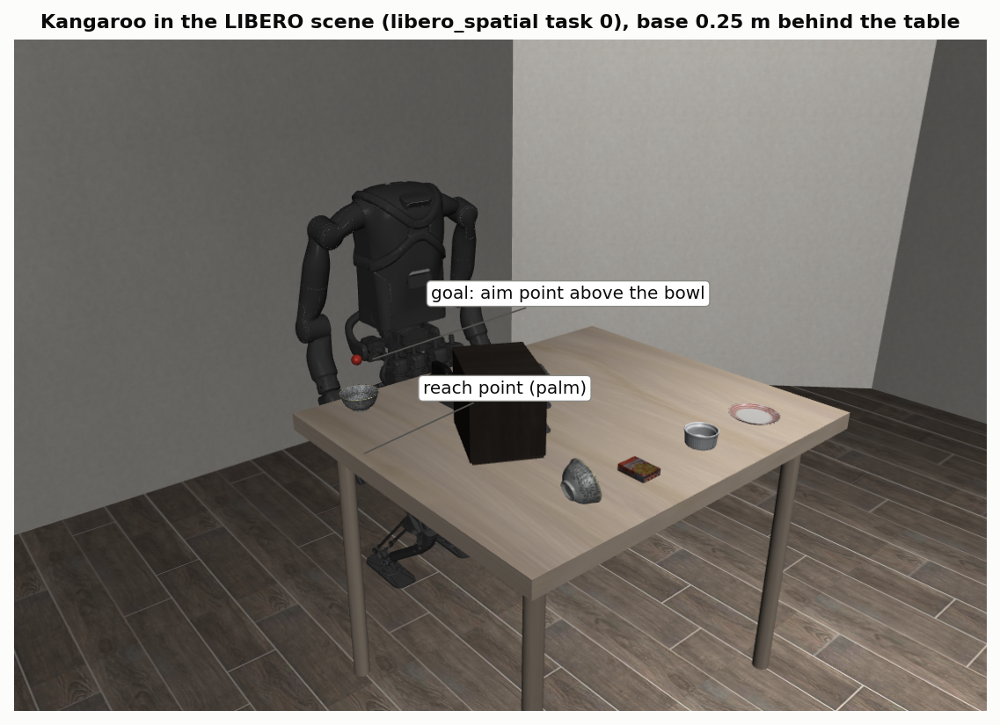
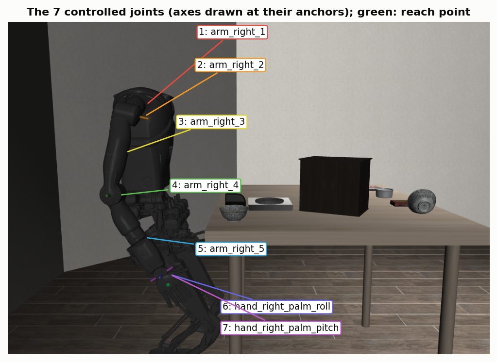
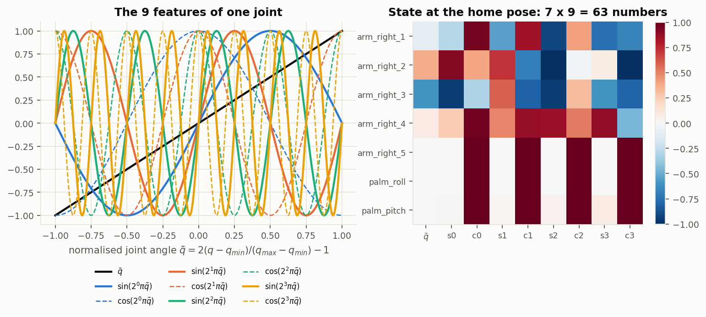
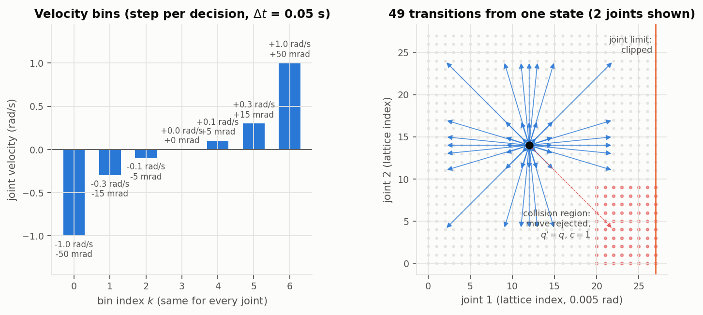
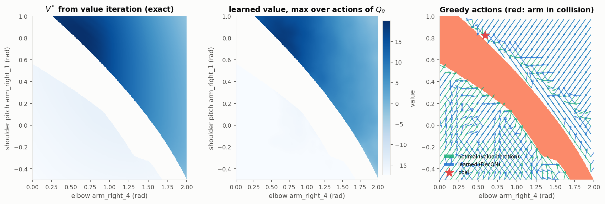
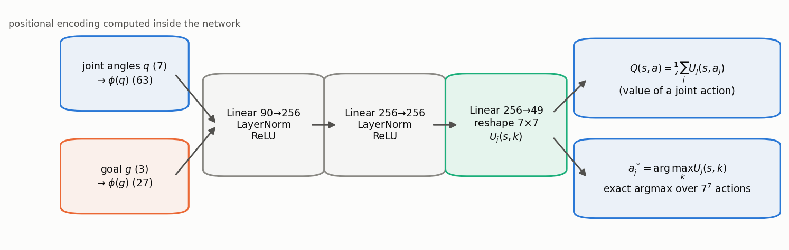
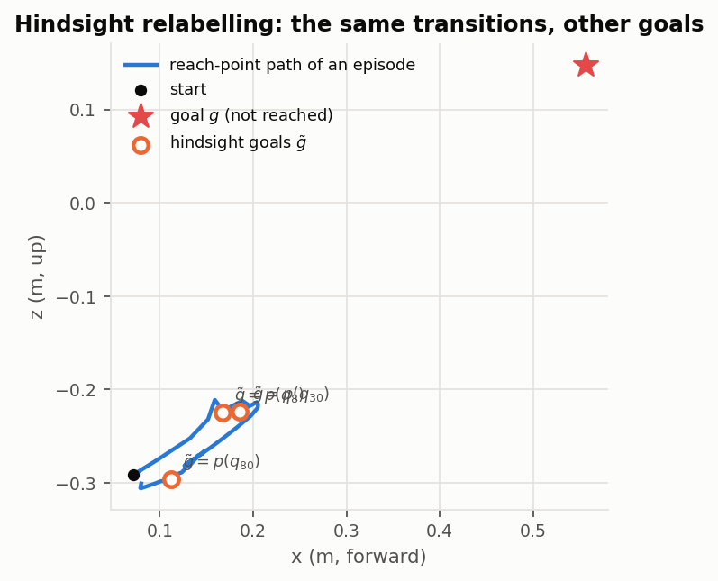
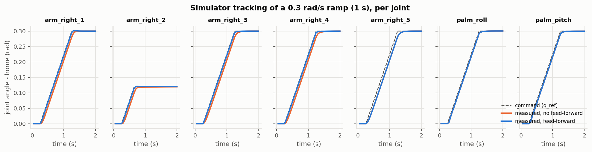

# Technical model: reaching where an object appears

This page is the mathematics of the experiment: what the state, the action, the transition rule and the
reward are, which Bellman equation is solved, how the learning rule solves it, and how the same decision
is executed in the simulator. Every section names the code that implements it. How to run everything:
[`README.md`](README.md). What came out: [`docs/results.md`](docs/results.md).

1. [The task](#1-the-task)
2. [State: positional encoding of the joints](#2-state-positional-encoding-of-the-joints)
3. [Action: discretised joint velocities](#3-action-discretised-joint-velocities)
4. [Transition rule](#4-transition-rule)
5. [Reward](#5-reward)
6. [Bellman equation](#6-bellman-equation)
7. [Solving it exactly on a 2-joint lattice](#7-solving-it-exactly-on-a-2-joint-lattice)
8. [Solving it by learning: factored Q-learning](#8-solving-it-by-learning-factored-q-learning)
9. [Hindsight relabelling](#9-hindsight-relabelling)
10. [Executing a decision in the simulator](#10-executing-a-decision-in-the-simulator)
11. [Goals, starts and measures](#11-goals-starts-and-measures)

## 1. The task



An object appears somewhere on the table. The Kangaroo moves its right arm until its hand is at the object:
the goal is the place where the object appeared, so where the robot is reaching is always known. A new
object position is a new goal for the same policy (retargeting): nothing is retrained.

- **Robot.** PAL Kangaroo in LIBERO (Kangaroo_Libero, robosuite 1.4, MuJoCo 3.4), fixed base. The arm has 5
  joints; with the two wrist joints of the RH8D hand the controlled chain has 7 (figure below). The other 31
  command channels (legs, waist, left arm, fingers) hold their home positions.
- **Reach point** $p(q)$: PAL's `hand_right_manipulation_link`, 5 cm from the wrist centre along the fingers.
  Kangaroo_Libero's `right_grip_site` sits exactly where the two wrist axes cross, so the wrist could not move
  it; the manipulation link moves with all 7 joints.
- **Placement.** The robot base sits 0.25 m behind the table edge (Kangaroo_Libero's default is 0.55 m). At the
  default only a ~9 cm strip of the table is within reach at object height; at 0.25 m it is ~39 cm deep
  (measured: [`docs/results/probe.json`](docs/results/probe.json)). The change is a settings override read
  through `KANGAROO_CONFIG`; the simulator repository is not modified.
- **Frames.** Positions are in the robot base frame (`robot0_base_link`): x forward, y left, z up. The table's
  near edge is at x = 0.25 m and its top at z = 0.



| # | Joint | Range (rad) | Home (rad) | Actuation in the simulator |
| --- | --- | --- | --- | --- |
| 1 | `arm_right_1_joint` (shoulder pitch) | -2.618 .. 2.618 | -0.24 | torque, PD kp 400 / kd 20 + gravity compensation |
| 2 | `arm_right_2_joint` (shoulder roll) | -1.134 .. 2.443 | 1.32 | same |
| 3 | `arm_right_3_joint` (upper-arm rotation) | -2.618 .. 2.618 | -1.57 | same |
| 4 | `arm_right_4_joint` (elbow) | -1.134 .. 2.443 | 0.80 | same |
| 5 | `arm_right_5_joint` (forearm roll) | -1.570 .. 1.570 | 0.00 | same |
| 6 | `hand_right_palm_roll_joint` (wrist) | -0.785 .. 0.785 | 0.00 | MuJoCo position actuator, kp 100 |
| 7 | `hand_right_palm_pitch_joint` (wrist) | -0.785 .. 0.785 | 0.00 | same |

**Built:** `kangaroo_rl/scene.py` (everything here is read from the compiled LIBERO model at start-up).

## 2. State: positional encoding of the joints

The state is the joint positions and the goal,

```math
s_t = \big(\phi(q_t),\ \phi_g(g)\big), \qquad q_t \in \mathbb{R}^7,\ g \in \mathbb{R}^3 .
```

Each joint angle is normalised to $[-1, 1]$ over its range and encoded with the sinusoidal positional encoding
of Transformers and NeRF, $L = 4$ frequencies:

```math
\tilde q_j = 2\,\frac{q_j - q_j^{\min}}{q_j^{\max} - q_j^{\min}} - 1, \qquad
\phi(\tilde q_j) = \big[\tilde q_j,\ \sin(2^0\pi\tilde q_j),\ \cos(2^0\pi\tilde q_j),\ \dots,\ \sin(2^{3}\pi\tilde q_j),\ \cos(2^{3}\pi\tilde q_j)\big].
```

That is 9 numbers per joint, 63 for the arm. The goal is normalised to the goal box (section 11) and encoded
the same way (27 numbers). The highest frequency has a period of 1/8 of the joint range, so a change of one
fine velocity step (0.005 rad) moves the features about 30 times more than it moves $\tilde q$ alone: the
network can resolve the millimetre-scale differences that decide the last centimetre. The comparison run
uses $L = 0$ (raw normalised angles).



**Why the goal is in the state.** With the goal left out, two episodes in the same joint configuration but
with different objects would earn different rewards for the same action: the reward would not be a function
of the state, and the problem would not be Markov. With $g$ in the state, one policy serves every object
position. This is a goal-conditioned value function (UVFA, Schaul et al. 2015).

**What is not in the state.** Joint velocities. In the model (section 4) the next state depends only on $q$
and the action, so $q$ is enough. In the simulator the arm also has momentum and a small tracking lag;
section 10 measures what leaving it out costs.

**Built:** `kangaroo_rl/encoding.py`; the encoding is evaluated inside the network
(`kangaroo_rl/agent/network.py`), so stored transitions hold raw joint angles.

## 3. Action: discretised joint velocities

Every joint chooses one of $K = 7$ velocities, the same set for all joints:

```math
a = (k_1, \dots, k_7),\quad k_j \in \{0,\dots,6\},\qquad
v_j(a) = v_{\max}\, b_{k_j},\quad b = (-1,\ -0.3,\ -0.1,\ 0,\ 0.1,\ 0.3,\ 1),\quad v_{\max} = 1\ \text{rad/s}.
```

A decision lasts $\Delta t = 0.05$ s (20 Hz), so a joint moves by 0, ±0.005, ±0.015 or ±0.05 rad per
decision. The fine levels give precision near the goal: 0.005 rad at the shoulder moves the hand about 4 mm.
The coarse level crosses the workspace in about a second. The full action space is $7^7 = 823{,}543$ joint
actions.



**Built:** `VelocityBins` in `kangaroo_rl/mdp.py`.

## 4. Transition rule

The model the Bellman equation is written for, and the one training runs on:

```math
\hat q = \mathrm{clip}\big(q + \Delta t\, v(a),\ q^{\min},\ q^{\max}\big),\qquad
(q', c) = T(q, a) =
\begin{cases}
(q,\ 1) & \text{if the arm at } \hat q \text{ penetrates the table or the robot,}\\
(\hat q,\ 0) & \text{otherwise,}
\end{cases}
\qquad g' = g .
```

- **Integration and clipping:** the commanded velocity acts for one decision period; a joint at its limit
  stays there.
- **Collision rejection:** a move into collision does not happen, like a wall in a grid world. The flag $c$
  is penalised in the reward. Collisions are found with MuJoCo (`mj_kinematics` + `mj_collision`) on a copy of
  the scene's compiled model. Only right-arm geometry (25 meshes, hand included) is tested against the
  table, the rest of the robot and the arm itself. The movable objects are ignored, and pairs already
  touching at home are excused (there are none). On 200 random poses this test agrees exactly with full
  contact detection on the simulator's model (`tests/test_sim.py`). One test costs about 0.1-0.2 ms.
- **Determinism:** $P(s' \mid s, a) = \delta\big(s' - T(s, a)\big)$. The goal never changes during an episode,
  and $T$ does not depend on it.

From the home pose the hand hangs below the table top, so a straight move to any goal over the table runs
into the table edge. Reaching a goal means lifting first and then going over the edge. The rejection rule
makes the table a real obstacle for every learner (section 11, baselines).

**Built:** `TransitionRule` and `step_model` in `kangaroo_rl/mdp.py`; batched over copies in
`kangaroo_rl/envs/kinematic.py`.

## 5. Reward

With $d = \lVert p(q') - g \rVert$ the distance from the reach point to the goal after the step:

```math
r(s, a, s') = -\min\!\Big(\frac{d}{d_{\mathrm{far}}},\ 1\Big) + \exp\!\Big(-\frac{d^2}{2\sigma^2}\Big)
- \lambda_c\, c - \lambda_a\, \frac{\lVert v(a)\rVert^2}{7\, v_{\max}^2},
\qquad d_{\mathrm{far}} = 0.5\ \text{m},\ \sigma = 0.02\ \text{m},\ \lambda_c = 1,\ \lambda_a = 0.01 .
```

| Term | What it does |
| --- | --- |
| linear distance | guides from far away: every metre gained is worth the same, saturating beyond 0.5 m |
| Gaussian bonus | a precision signal near the goal: 1 at the goal, 0.61 at 2 cm, 0.14 at 4 cm |
| rejection penalty | makes trying to move into the table worse than any other action |
| speed penalty | a small preference for slow motion, so the arm settles instead of dithering at the goal |

- **Bounds.** $r \in [-2.01, 1]$, so every return lies in $[r_{\min}, r_{\max}]/(1-\gamma) = [-40.2, 20]$.
  Learning targets are clipped to that interval.
- **No terminal states.** An episode ends only at its time limit, $H = 100$ decisions (5 s). Reaching the goal
  does not stop it: staying at the goal keeps earning the bonus, so the policy learns to hold, which
  retargeting needs. At the time limit the learning target still bootstraps from the true final state,
  because time is not part of the state (Pardo et al. 2018).

An optional potential-based shaping term, $\gamma\Phi(s') - \Phi(s)$ with $\Phi = -d/\delta$, leaves the optimal
policy unchanged (Ng et al. 1999; `reward.shaping`). It was tried and made learning slower, so it is off
([`docs/results.md`](docs/results.md), section 6).

**Built:** `Reward` in `kangaroo_rl/mdp.py`.

## 6. Bellman equation

The optimal action value of the model MDP satisfies

```math
Q^*(s, a) = r\big(s, a, T(s,a)\big) + \gamma \max_{a'} Q^*\big(T(s, a), a'\big), \qquad \gamma = 0.95 ,
```

and the optimal policy is greedy in it, $\pi^*(s) = \arg\max_a Q^*(s, a)$. The discount sets a horizon of
$1/(1-\gamma) = 20$ decisions, 1 s, which is about the time a reach takes.

**The goal-conditioned form.** Writing the state out,

```math
Q^*(q, g, a) = r(q, a, q', c; g) + \gamma \max_{a'} Q^*(q', g, a'), \qquad (q', c) = T(q, a)\ \text{for every } g .
```

Two facts make this equation useful for retargeting:

1. **The transition is the same for every goal.** Only the reward depends on $g$, and it is a known function of
   $(q', c, a, g)$. A transition collected while reaching one object is therefore a valid sample of the
   equation for every other goal. This is what hindsight relabelling uses (section 9).
2. **One function covers every object position.** Retargeting is evaluating $Q^*$ at the new $g$, with no
   new solve.

**In the simulator** the same decision has no exact $T$: the next measured state also depends on the arm's
velocity and tracking error, $q'_{\text{meas}} = T(q, a) + \delta(\dot q, q_{\text{ref}} - q)$. This is
deterministic but only partially observed through $q$. The equation is solved for the model; the
simulator measures how well the solution transfers (section 10).

**Why not solve it directly.** The state is continuous (at 0.005 rad resolution, about $10^{18}$ joint
configurations for 7 joints) and there are $8.2\times10^5$ actions per state, so tabular dynamic
programming is impossible. Section 7 solves it exactly where it is small enough. Section 8 learns it
with a function approximator.

## 7. Solving it exactly on a 2-joint lattice

Keep only shoulder pitch (joint 1) and elbow (joint 4) moving, and freeze the other five at home. On a
lattice with spacing $h = 0.005$ rad every velocity bin moves a whole number of lattice steps
($v_{\max} b_k \Delta t / h \in \{0, \pm1, \pm3, \pm10\}$). The transition rule then maps lattice points
to lattice points and the MDP is finite. Joint 1 runs over $[-0.5, 1.0]$ and joint 4 over $[0, 2]$ rad:
301 × 401 = 120,701 states, 49 actions. In this slice the hand moves in a vertical plane that cuts the
table edge, so the optimal paths have to go around it.

Value iteration applies the Bellman operator until it stops changing ($\max_s |V_{k+1}-V_k| < 10^{-6}$):

```math
V_{k+1}(s) = \max_{a} \Big[ r\big(s, a, T(s,a)\big) + \gamma\, V_k\big(T(s,a)\big) \Big].
```

The same agent as in section 8 is trained on the same 2-joint problem, and its greedy actions and values
are compared with the exact $Q^*$ at every lattice state. A greedy action counts as near-optimal when its
$Q^*$ is within 1% of the value range of the best one. This checks directly that the learning rule solves
the equation written above.



**Built:** `kangaroo_rl/dp.py` (lattice, transition tables, value iteration, comparison),
`kangaroo_rl/dp_check.py` (command), `configs/slice2.yaml`.

## 8. Solving it by learning: factored Q-learning

**Factored action values.** A network outputs one utility per joint and bin, $U_j(s, k)$ (7 × 7 numbers).
The value of a joint action is their mean (DecQN, Seyde et al., ICLR 2023):

```math
Q_\theta(s, a) = \frac{1}{7}\sum_{j=1}^{7} U_j(s, a_j; \theta) .
```

Because $Q_\theta$ is a sum of per-joint terms, its maximum over all $7^7$ joint actions is the sum of
per-joint maxima. Greedy action selection and the max in the Bellman target are therefore exact and cost
$7 \times 7$ evaluations:

```math
\max_a Q_\theta(s, a) = \frac{1}{7}\sum_j \max_k U_j(s, k), \qquad a^*_j = \arg\max_k U_j(s, k) .
```

`tests/test_mdp.py` checks this against a brute-force search over all 823,543 joint actions. To first order
in $\Delta t$ the true $Q^*$ is close to additive: the change in distance is $\nabla_q d \cdot v\,\Delta t$,
a sum over joints, and the speed penalty is a sum over joints too. Joint coupling enters through
collisions and through curvature over several steps.

**Learning rule.** Fitted Q-iteration on replayed transitions, with a Double-Q target from a slowly moving
copy $\theta^-$ of the network. The target is the $n$-step form of the Bellman backup, $n = 3$:

```math
y = \sum_{i=0}^{m-1}\gamma^i r_{t+i} + \gamma^{m}\, Q_{\theta^-}\big(s_{t+m}, \hat a\big),\quad
\hat a_j = \arg\max_k U_j(s_{t+m}, k; \theta),\quad m = \min(n,\ H - t),\qquad
y \leftarrow \mathrm{clip}\Big(y,\ \tfrac{r_{\min}}{1-\gamma},\ \tfrac{r_{\max}}{1-\gamma}\Big),
```

Unrolling the Bellman equation of section 6 $n$ times gives the same fixed point for the policy that
generated the data. Here the data comes from the ε-greedy policy, so the target is slightly biased towards
it; the bias vanishes as ε falls to 0.02. The benefit is speed. Reaching from below the table needs a detour
(lift, then cross the edge), and with $n = 3$ the value of the detour travels back three decisions per
backup instead of one. The first configuration of this study used $n = 1$. It reached a 6.4 cm median after
1 M steps, against about 10 cm already at 275 k with $n = 3$ ([`docs/results.md`](docs/results.md),
section 6). With hindsight goals every one of the $m$ rewards is recomputed for the relabelled goal.

```math
L(\theta) = \mathbb{E}_{(s,a,r,s') \sim \mathcal{D}}\ \mathrm{Huber}\big(y - Q_\theta(s, a)\big),\qquad
\theta^- \leftarrow (1-\tau)\,\theta^- + \tau\,\theta .
```

The TD error is fitted on the joint action actually taken. A per-branch target in the style of BDQ
(Tavakoli et al. 2018) has a fixed point that is not $Q^*$ of the joint MDP, so it is not used.

**The sequential alternative.** The additive form cannot represent how the joints interact. Near the goal,
small moves of all seven joints add up to an overshoot, and that is where the main runs stall
([`docs/results.md`](docs/results.md), section 5). An autoregressive factorisation (Metz et al. 2017;
Chebotar et al. 2023) conditions each joint on the bins already chosen for the earlier joints, and backs up
across joints inside a decision:

```math
Q_j(s, a_{<j}, a_j) \leftarrow \max_k Q_{j+1}(s, a_{\le j}, k)\quad (j < 7),\qquad
Q_7(s, a) \leftarrow R + \gamma^m \max_k Q_1(s', k).
```

The sequential argmax is then the exact greedy joint action. It is implemented and tested
(`kangaroo_rl/agent/seqq.py`, `agent.kind: sequential`) but learned too slowly for this study's CPU budget,
so the results use the additive form.



| Setting | Value |
| --- | --- |
| network | 90 inputs (63 + 27 encoded) → 256 → 256 (LayerNorm, ReLU) → 49 utilities |
| optimiser | Adam, learning rate 3e-4, batch 256, Huber loss, gradient clip 10 |
| target network | Polyak averaging, τ = 0.005 per update |
| data | 16 model copies in parallel, 4 updates per vector step (one update per 4 transitions), replay of 10⁶ transitions, 3-step returns |
| exploration | per joint, ε from 1.0 to 0.02 over the first 15% of training. An exploring joint repeats one random bin for 1-10 steps, so random motion travels instead of jittering. |
| warm-up | 10,000 random steps before the first update |

**Built:** `kangaroo_rl/agent/network.py`, `kangaroo_rl/agent/decqn.py` (target, loss, Polyak, explorer),
`kangaroo_rl/train.py` (loop).

## 9. Hindsight relabelling

An episode that misses its goal still shows exactly how to reach every point the hand passed through. With
the "future" strategy (Andrychowicz et al. 2017), 80% of sampled transitions get their goal replaced by the
reach point achieved at a uniformly chosen later step of the same episode:

```math
\tilde g = p(q_{t'}),\quad t' \sim \mathcal{U}\{t, \dots, H-1\},\qquad
\tilde r = r(q_t, a_t, q_{t+1}, c_t;\ \tilde g) .
```

Section 6 is what makes this valid: $(q_{t+1}, c_t) = T(q_t, a_t)$ holds whatever the goal, and the reward
is recomputed for $\tilde g$ from the stored $(q_{t+1}, c_t, a_t)$. The replay stores raw joint angles,
actions, the rejection flag and $p(q_{t+1})$, and never rewards (`kangaroo_rl/agent/replay.py`).



## 10. Executing a decision in the simulator

Kangaroo_Libero accepts only absolute joint-position targets, at 100 Hz, and applies
$\tau = k_p(q_{\text{target}} - q) - k_d \dot q + \text{gravity compensation}$ to the arm motors. One decision
is 5 of its ticks. The reference is interpolated over those ticks, with a velocity feed-forward on the target:

```math
q_{\text{ref}}(m) = q_0 + \tfrac{m}{5}\,(q_{\text{cmd}} - q_0),\quad m = 1..5,\qquad
q_{\text{target}} = \mathrm{clip}\big(q_{\text{ref}}(m) + \tau_j\, v\big),\qquad \tau_j = k_d / k_p = 0.05\ \text{s}.
```

- **Feed-forward.** A PD law with $-k_d\dot q$ lags a ramp by $k_d v / k_p$, a whole decision at these gains.
  The feed-forward cancels it, which cuts the peak tracking error of joints 1-4 from 0.020 to 0.005 rad. It is
  not used on two kinds of joint:
  - The forearm roll's inertia (0.011 kg m²) is too small for the explicitly applied $k_d$ ($k_d\,dt/M = 3.6$),
    so a lead there excites a numerical oscillation.
  - The wrist joints are position actuators without a velocity term.
- **Command.** $q_{\text{cmd}}$ comes from the same rule $T$ as in the model, including collision rejection
  against the static scene.



**Two observation modes.** The state is joint positions only, so the simulator is partially observed. Both
ways of reading the joints are measured:

| Mode | The policy sees | The reference integrates from | What it tests |
| --- | --- | --- | --- |
| A | $q_{\text{ref}}$, the commanded positions (they evolve exactly by $T$) | $q_{\text{ref}}$ | the policy on its own model; tracking error shows up as reach error |
| B | the measured positions | the measured positions | closed loop on the robot's encoders |

Accuracy is always measured on the simulated hand. The gap between A and B is the cost of leaving joint
velocity out of the state.

**The object.** At the start of a simulator episode the LIBERO bowl `akita_black_bowl_2` appears on the
table under the goal. The goal is the aim point 15 cm above the bowl's base, about 10 cm above its rim. The
palm hovers over the bowl because the fingers extend 11 cm beyond the reach point, and the bowl weighs 6 g:
any touch would throw it. The other objects of the task are moved to the far side of the table, out of reach.
The bowl's displacement is reported, as a check that the hand did not touch it.

**Built:** `kangaroo_rl/envs/libero.py`, measured by `scripts/probe_model.py`.

## 11. Goals, starts and measures

**Goals: where an object can appear.** A box relative to the table:

| Axis | Range |
| --- | --- |
| x | 3-40 cm beyond the near edge |
| y | -0.60 to 0.30 m |
| z | 4-30 cm above the top |

Only points the reach point attains without collision are used. Two million uniformly random joint
configurations are sampled, the collision-free reach points inside the box are kept, and the result is
thinned to one point per 2 cm voxel. Sampling from this pool is uniform over the reachable volume, not over
joint space (8,508 points, `GoalPool` in `kangaroo_rl/mdp.py`).

**Episode starts.**

| Share | Start |
| --- | --- |
| 50% | where the previous episode ended, with a new goal: the retargeting situation |
| 25% | home, with 0.05 rad noise |
| 25% | a uniformly random collision-free pose |

**Measures** (`kangaroo_rl/metrics.py`).

- Final distance $d_H$ after 5 s: median, 90th percentile, max.
- Share of goals within 1, 2 and 5 cm.
- Time to first come within 2 cm.
- Share of the last second spent within 2 cm (holding).
- Share of moves rejected.
- In the simulator only: joint tracking error and the bowl's displacement.

**Evaluation sets.**

- *Model:* 256 held-out goals (a fixed seed, the same for every run), from home and chained. In a chain each
  goal starts where the previous one ended.
- *Simulator:* 64 goals where the bowl rests fully on the table. Each is checked first to be reachable by
  the continuous Jacobian controller.

**Reference controllers** (`kangaroo_rl/baselines.py`). A damped-least-squares Jacobian controller,
$\dot q = J^\top (J J^\top + \lambda^2 I)^{-1}(w - p)/T$. It uses the model's kinematics and the table
geometry, neither of which the agent sees, and follows a scripted waypoint $w$: lift, cross the edge at a
safe height, descend. It runs in two versions:

- *Binned to the same 7 velocity levels*, with the rounding error carried to the next step. This shows what
  the action discretisation allows.
- *Continuous*: the precision ceiling.

Without the waypoint it stalls under the table edge on every goal.
