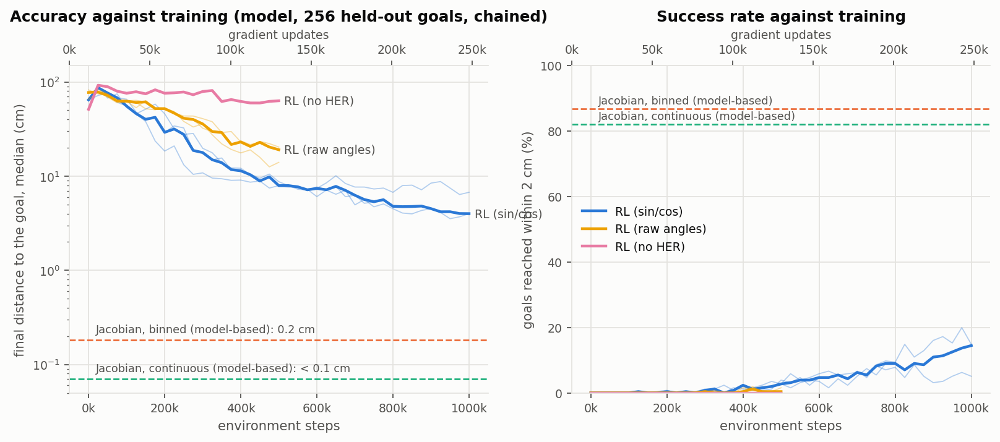
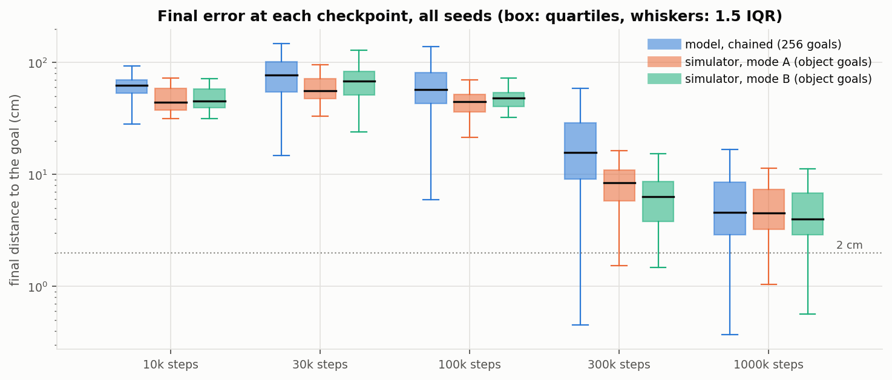
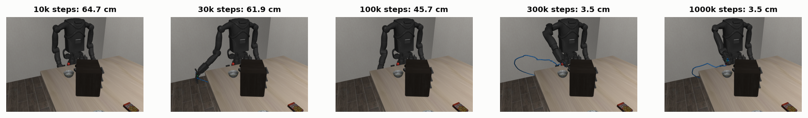
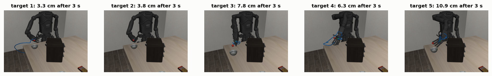
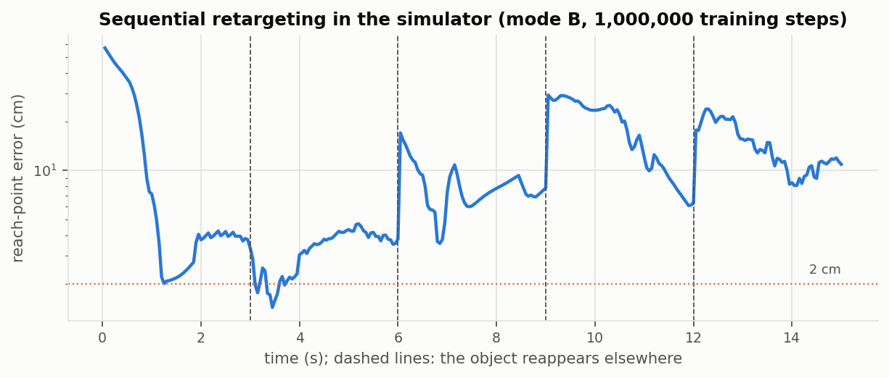
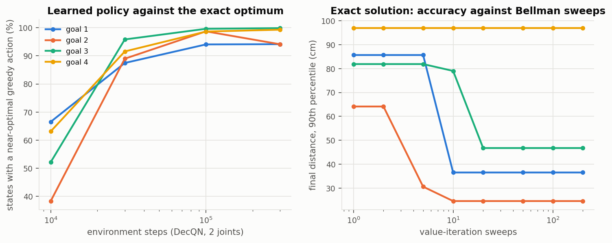
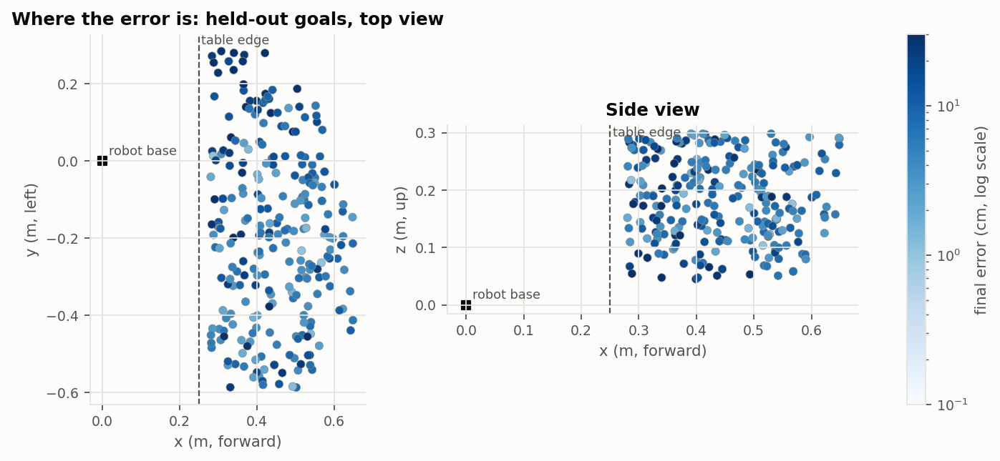

# Results: reaching where an object appears

Date: 2026-10-20, branch `rl-retargeting`. Image `kangaroo-rl:0.1.0` (sha256:0cf96a00…) on Kangaroo_Libero
`c7be874`; every run's `run.json` records both commits and the image. All training and evaluation ran on the
CPU: the laptop's CUDA driver failed after a suspend, so the GPU was used only for rendering.

What the model is: [`../TECHNICAL.md`](../TECHNICAL.md). How to rerun any of this:
[`../README.md`](../README.md), sections 4-6. The tables in full: [`results/data/`](results/data). The
pass marks were set beforehand in [`tests.md`](tests.md).

## Summary

- **Accuracy grows with training, from 62 cm to 4.6 cm.** These are median final errors on 256 held-out
  goals in the model, chained (each goal starts where the previous one ended), pooled over 3 seeds. After
  1 M steps (250 k gradient updates) the seeds end at 6.7, 3.9 and 4.0 cm.
- **Little happens for the first 100 k steps, then the error falls steeply.** It drops from 57 cm at 100 k to
  16 cm at 300 k, then keeps falling slowly. The curve has not flattened at 1 M.
- **In the simulator the result transfers.** With the bowl appearing on the table, the final checkpoints end
  3.2-4.5 cm from the goal in the median. Velocity left out of the state costs nothing measurable: reading
  measured joints (mode B) gives 3.2-4.0 cm, against 3.3-4.5 cm when reading the commanded ones (mode A).
- **The arm reaches but does not hold.**
  - 50-69% of the goals are passed within 2 cm during the 5 s.
  - Only 9-19% end within 2 cm (model and simulator).
  - The hand drifts or dithers a few centimetres around the goal (section 5).
  This is the main shortfall: **the accuracy pass marks are missed** (median 4.6 cm against ≤ 1 cm).
- **The learning rule solves the Bellman equation it is written for.** On the 2-joint lattice, where the
  equation can be solved exactly, the learned greedy action is near-optimal in 94-100% of 120,701 states.
  The learned values correlate 0.998-1.000 with V* (pass mark ≥ 90%: met).
- **Both design choices matter.**
  - Without the sin/cos encoding (raw angles) the error at 500 k steps is 14-20 cm, against 7.8-8.7 cm.
  - Without hindsight relabelling it is 63 cm: the agent barely learns.
- **A model-based controller does far better.** A Jacobian controller binned to the same 7 velocity levels
  reaches 0.2 cm, so the action discretisation is not the limit. It uses the arm's kinematics and a scripted
  way over the table edge; the RL agent sees only joint angles and the goal.

## 1. What was run

| Run | Config | Seeds | Steps | Purpose |
| --- | --- | --- | --- | --- |
| main | `configs/reach.yaml` (sin/cos L = 4, 3-step returns, HER 0.8) | 3 | 1 M | the experiment |
| raw angles | `configs/reach_raw.yaml` | 3 | 500 k | does the positional encoding matter |
| no HER | `configs/reach_noher.yaml` | 1 | 500 k | does hindsight relabelling matter |
| 2 joints | `configs/slice2.yaml` | 1 | 300 k | exact Bellman check |
| tuning | seed 0, see section 6 | 1 | 150 k - 1 M | how the main config was chosen |
| reference | random; Jacobian binned; Jacobian continuous | - | - | floor and ceilings |

**Evaluations.**
- *Model:* 256 held-out goals (same for every run), from home and chained, every 25 k steps during training,
  and for every checkpoint.
- *Simulator:* Kangaroo_Libero physics, 64 goals where the bowl appears fully on the table, modes A and B.
  Run for every checkpoint of seed 0 and the final checkpoints of seeds 1 and 2.

Episodes last 5 s (100 decisions).

## 2. Accuracy against the number of training iterations

Model, 256 held-out goals per seed, pooled over 3 seeds (768 goals per row). Gradient updates = (steps -
10 k warm-up) / 4.

| Steps | Updates | Chained median / p90 (cm) | From home median / p90 (cm) | Within 1 / 2 / 5 cm (chained) | Passed within 2 cm | Moves rejected |
| --- | --- | --- | --- | --- | --- | --- |
| 10 k | 0 | 62.3 / 78.7 | 64.0 / 78.0 | 0 / 0 / 0% | 0% | 98% |
| 30 k | 5 k | 77.2 / 120.6 | 76.2 / 119.6 | 0 / 0 / 0% | 0% | 32% |
| 100 k | 22.5 k | 57.5 / 110.5 | 51.6 / 114.9 | 0 / 0 / 0% | 0% | 46% |
| 300 k | 72.5 k | 15.7 / 46.3 | 14.3 / 79.1 | 0.1 / 0.8 / 8.3% | 10% | 18% |
| 1 M | 247.5 k | **4.6** / 17.0 | 4.1 / 13.9 | 2.6 / 11.6 / 54% | 50% | 7.5% |

The simulator follows the model. For seed 0, every checkpoint with the bowl on the table:

| Steps | Mode A median / p90 (cm) | Mode B median / p90 (cm) | Within 5 cm (A / B) |
| --- | --- | --- | --- |
| 10 k | 44.1 / 66.1 | 45.1 / 64.5 | 0 / 0% |
| 30 k | 55.9 / 90.7 | 68.2 / 95.8 | 0 / 0% |
| 100 k | 44.7 / 65.9 | 48.0 / 66.7 | 0 / 0% |
| 300 k | 8.5 / 15.7 | 6.3 / 13.2 | 17 / 41% |
| 1 M | 4.5 / 13.8 | 4.0 / 10.5 | 59 / 63% |

The same goal reached by successive checkpoints (seed 0, simulator, mode B):

In words:
- **The first 100 k steps are exploration and the warm-up of the value function.**
  - At 10 k the greedy policy is a fixed arbitrary action, and 98% of its moves run into the table or the
    body.
  - At 30-100 k it moves, but mostly in the wrong direction.
- **Between 100 k and 300 k it learns to lift the hand over the table edge.** The error falls by a factor of
  4 and rejected moves fall to 18%.
- **From 300 k to 1 M it refines.** The error falls by another factor of 3; the share within 5 cm goes from
  8% to 54%.
- **The curve is still falling at 1 M steps.** A longer run would improve further, but the slope (about a
  factor of 1.5 over the last 300 k steps) suggests 1 cm would need many millions of steps with this method.

## 3. In the simulator

Final checkpoints, 64 object goals, bowl appearing at each:

| Seed | Mode | Median / p90 / max (cm) | Within 1 / 2 / 5 cm | Passed within 2 cm | Time to 2 cm | Last second within 2 cm | Joint tracking (median) |
| --- | --- | --- | --- | --- | --- | --- | --- |
| 0 | A | 4.5 / 13.8 / 39.4 | 0 / 9 / 61% | 66% | 1.4 s | 11% | 0.029 rad |
| 0 | B | 4.0 / 10.5 / 21.9 | 3 / 9 / 63% | 58% | 1.3 s | 13% | 0.039 rad |
| 1 | A | 4.1 / 40.0 / 54.1 | 5 / 19 / 63% | 58% | 1.1 s | 20% | 0.018 rad |
| 1 | B | 3.2 / 10.1 / 53.6 | 8 / 16 / 69% | 69% | 1.2 s | 20% | 0.011 rad |
| 2 | A | 3.3 / 16.4 / 54.1 | 3 / 19 / 70% | 69% | 1.3 s | 19% | 0.026 rad |
| 2 | B | 3.7 / 8.1 / 19.3 | 2 / 11 / 70% | 63% | 1.5 s | 12% | 0.023 rad |
| Jacobian binned | A / B | 0.08 / 1.3 · 0.09 / 1.2 | 94 / 92% within 2 cm | | | | |
| Jacobian continuous | A / B | 0.08 / 0.9 · 0.10 / 1.0 | 94 / 92% within 2 cm | | | | |
| random | A / B | 61.5 · 62.5 | 0% | | | | |

In words:
- **The simulator is no harder than the model.** The object goals are easier than the model's held-out set
  (fixed height, objects fully on the table), so the simulator numbers are slightly better.
- **Modes A and B are the same to within the seed spread** (A - B = +0.5, +0.9, -0.4 cm). The arm tracks the commanded joints to about
  0.02 rad, small next to the centimetres of policy error.
- **The bowl was not touched.** Its median displacement is 0-4 mm.
  - One of the 64 placements is the exception: there the bowl is pushed 1.36 m by the scene itself, for
    every controller including the random one. The goal overlaps a scene fixture, so this is a placement
    artefact, not contact.

**Sequential retargeting** (seed 2, mode B). The bowl reappears at a new place every 3 s and the arm continues
without a reset. Each time, the hand comes within about 2-5 cm of the new place within about a second.
Final errors at the five targets: 3.3, 3.8, 7.8, 6.3 and 10.9 cm.

## 4. The exact check: learned Q against the Bellman solution

On the 2-joint lattice (shoulder pitch and elbow, 120,701 states, 49 actions) value iteration converges in a
few hundred sweeps. Training the same agent on the same problem and comparing at every state, for 4 goals:

| Steps | Near-optimal greedy actions | Value correlation with V* | Rollout median, learned / optimal (cm) |
| --- | --- | --- | --- |
| 10 k | 38-67% | 0.08-0.36 | 27-45 / 0.0 |
| 30 k | 87-96% | 0.94-0.99 | 2.5-9.8 / 0.0 |
| 100 k | 94-100% | 0.991-0.999 | 1.2-2.0 / 0.0 |
| 300 k | 94-100% | 0.998-1.000 | 0.7-5.1 / 0.0 |

In words:
- **The learning rule converges to the solution of the stated Bellman equation.** That includes the detour
  around the table edge, visible in the shape of V* in [`TECHNICAL.md`](../TECHNICAL.md) section 7.
- **Value iteration needs 10-20 sweeps to propagate the value of going around the edge.** That is the exact
  counterpart of the "nothing happens, then a steep fall" seen in the 7-joint learning curve.
- **With only two joints, no goal over the table can be reached from home.** The table edge separates
  them, and even the optimal policy ends 24-81 cm away. The 2-joint run's from-home curve (about 40 cm
  throughout) is therefore not a measure of learning; the comparison above starts from every state.

## 5. Why the main runs stop at a few centimetres

The arm almost always gets close; it does not stay. On 64 goals with the seed-0 final checkpoint, among those
that end between 2 and 20 cm:
- the hand still moves about 0.8 cm back and forth in the last second
- only 25% of the joint commands are zero
- fast bins (1 rad/s) are still being chosen
- only 10% of moves are rejected, so the table is not what stops it
- many of these episodes passed within 0.5-1.3 cm earlier and drifted away

The Q-function is additive over joints: Q = mean of per-joint utilities. That is accurate far from the goal,
where the distance changes almost linearly with each joint's velocity. Near the goal the best move of one
joint depends on what the other six do, because small moves of all seven add up to an overshoot, and an
additive Q cannot represent that. The evidence:
- with 2 joints the same method gets to about 1 cm
- with 7 it stalls at 4-7 cm
- the model-based controller, which coordinates the joints through the Jacobian, reaches 0.2 cm with the
  same bins

Section 6 lists what was tried against it.

## 6. How the configuration was chosen

Seed 0, model, chained median (`results/data/tuning.csv`):

| Variant | 300 k | 500 k | 1 M | Kept |
| --- | --- | --- | --- | --- |
| v1: one-step targets | 15.9 cm | 10.3 cm | 6.4 cm | history |
| **v2: 3-step returns** | 10.8 cm | 7.9 cm | 6.7 cm | **adopted** |
| v2 + potential-based shaping, δ = 0.05 / 0.02 m | 59.5 / 51.2 cm at 150 k | | | no: slower |
| v2 + 512-wide network | 24.0 cm at 250 k | | | no: slower |
| v2 with the sequential (autoregressive) factorisation | 67.8 cm | | | no: much slower to learn |
| v2 + speed penalty 0.1 / 0.3 | 22.3 / 21.7 cm | 9.5 / 10.0 cm | | no |

- **3-step returns** halve the error at 300 k by carrying the value of the detour over the table edge back
  faster. At 1 M the two are equal on seed 0; seeds 1-2 of v2 reach 3.9-4.0 cm.
- **The sequential factorisation** removes the additive limitation in principle (TECHNICAL.md section 8 and
  `kangaroo_rl/agent/seqq.py`, tested), but it learned too slowly to finish within this study's CPU budget.
- **None of the variants** broke the few-centimetre plateau within 1 M steps.

## 7. Comparisons

| Configuration (seeds) | Chained median at 500 k steps |
| --- | --- |
| sin/cos encoding, L = 4 (3) | 7.9 / 8.7 / 7.8 cm |
| raw normalised angles (3) | 14.0 / 20.4 / 19.1 cm |
| no hindsight relabelling (1) | 63.2 cm |

The positional encoding roughly halves the error at equal training. It lets the network resolve the
millimetre-scale joint changes the last centimetres need. Hindsight relabelling is essential: without it,
almost every episode misses its goal and the agent gets almost no signal.

## 8. Pass marks

| Check | Pass mark | Result | |
| --- | --- | --- | --- |
| Model, final checkpoint | median ≤ 1 cm, p90 ≤ 3 cm, ≥ 85% within 2 cm | 4.6 cm, 17.0 cm, 11.6% | **missed** |
| Simulator, modes A and B | median ≤ 1.5 cm | 3.2-4.5 cm | **missed** |
| Gap between modes A and B | median ≤ 0.5 cm | A - B = +0.5, +0.9, -0.4 cm (seeds 0-2) | **missed** for seed 1 (B better) |
| 2-joint exact check | ≥ 90% near-optimal greedy actions | 94-100% | met |
| More training helps | final better than 100 k in every seed | 57 → 4.6 cm, every seed | met |
| Bowl not touched | median displacement < 1 cm | 0-4 mm | met |

**What would close the gap**, in order of expected effect:
1. A factorisation that couples the joints near the goal: the sequential agent, trained longer on the GPU
   once the driver is reset (`sudo rmmod nvidia_uvm && sudo modprobe nvidia_uvm`).
2. Longer training: the curve is still falling at 1 M steps.
3. Joint velocities in the state, or a "hold" action, to make settling explicit.
